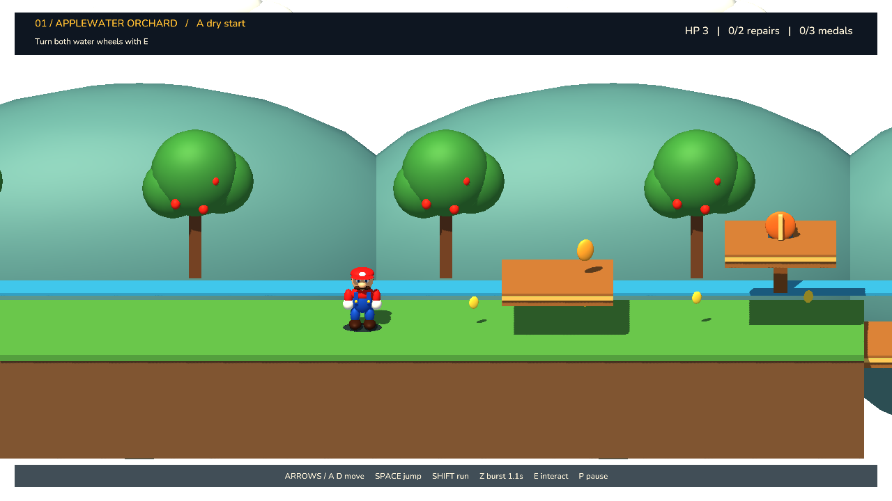

# Mario: The Last Train to Starfall

A five-stage Mario fan adventure with real 3D characters, geometry, lighting,
shadows, and a following camera. Movement stays on a side-scrolling plane.

Bowser Jr. has taken the festival train. Mario follows the railway, repairing
what Jr. broke and catching up before the train reaches Starfall Bridge.



[Compare the original game and the 3D pilot](previews/COMPARISON.md).

## Campaign

| Stop | Quest | Main challenge |
| --- | --- | --- |
| Applewater Orchard | Refill the spare engine by opening two water wheels | Jumping, raised paths, optional medals |
| Switchback Quarry | Release the two lift brakes | Riding moving platforms |
| Copperpipe Foundry | Restore power to the freight line | Reversing conveyor belts with Z |
| The Sky Express | Recover two conductor keys | Defeating guards between train cars |
| Starfall Engine | Vent the shield and stop Bowser Jr. | Three-hit boss with projectiles |

Each stage has three optional medals. Repairs and medals survive retries within
a stage. Clearing a stage saves the next unlocked stop and your best medal count
to `starfall-save.json` beside the executable. Re-entering a stage starts a new run.

## Play

Run `mario_level_1.exe`. The name is retained so existing shortcuts still work.

| Control | Action |
| --- | --- |
| Left/right arrows or A/D | Move |
| Space | Jump; hold for a higher jump |
| Left Shift | Run |
| Z | Star burst; recharges in 2.6 seconds |
| E | Operate a nearby wheel or lever |
| Enter | Start / continue dialogue / next stage |
| P or Escape | Pause |
| R | Return to the current checkpoint |
| M | Mute |
| F11 | Fullscreen |

The earlier Pygame Sunstone Trail remains available with `mario_level_1.exe --legacy`.

## Source and build

Python 3.13 is used for the Windows build.

```powershell
python3.13 -m venv .venv
.\.venv\Scripts\python.exe -m pip install -r requirements-build.txt
.\.venv\Scripts\python.exe mario_level_1.py
.\.venv\Scripts\python.exe -m PyInstaller --noconfirm --clean mario_level_1.spec
```

The rebuilt binary is placed in `dist`. Replace the root binary after testing it.

```powershell
.\.venv\Scripts\python.exe -m unittest discover -s tests -v
.\.venv\Scripts\python.exe mario_level_1.py --smoke-test
```

The smoke check runs 600 simulation frames and renders all five stages to
`previews/`. It also accepts `--output PATH` for packaged-build verification.

`adventure/campaign.py` contains the authored layouts and dialogue.
`adventure/simulation.py` handles movement and quest rules.
`adventure/models.py` defines the 3D character and scenery meshes.
`adventure/app.py` connects rendering, input, audio, menus, and saving.

This is an independent educational fan project. See `ASSET_CREDITS.md` and
`DESIGN_NOTES.md` for artwork credits and design references.
