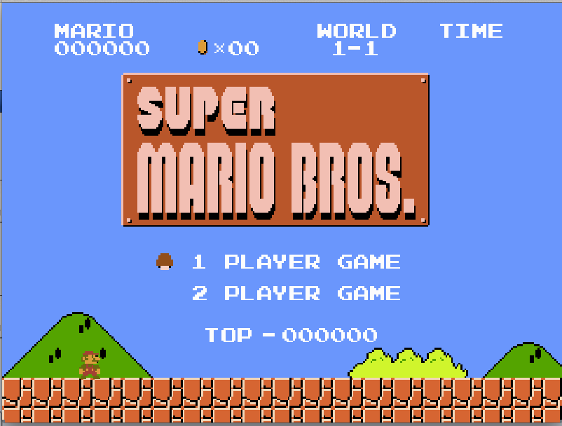
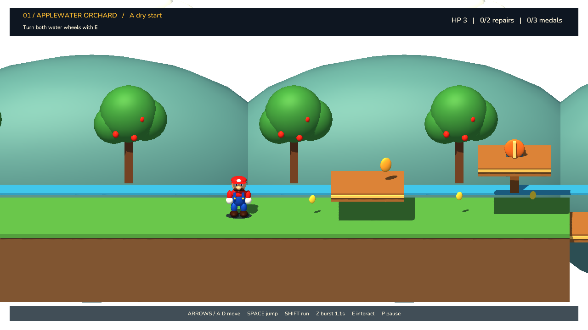
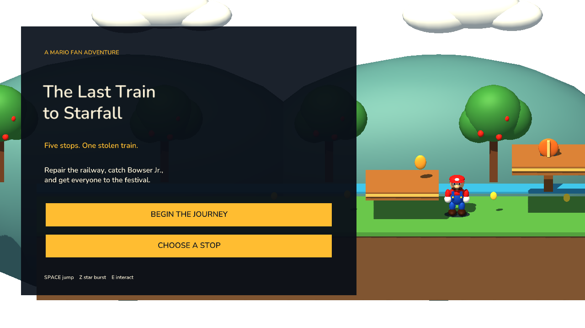
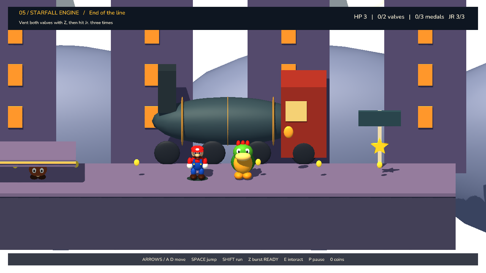

# Before and after: Mario pilot

| Original World 1-1 recreation | Starfall pilot |
| --- | --- |
|  |  |

The original was one flat, pixel-art course. The pilot uses 3D models, lighting, shadows, a following camera, and five connected stops. Mario repairs the orchard and quarry, reverses the foundry belts, recovers keys on the train, and stops Bowser Jr. in the engine.

| New title screen | Final encounter |
| --- | --- |
|  |  |

The screenshots show the actual game renderer. They are not concept art. The characters and environments are intentionally simple models; their detail and animation remain areas for later work.
