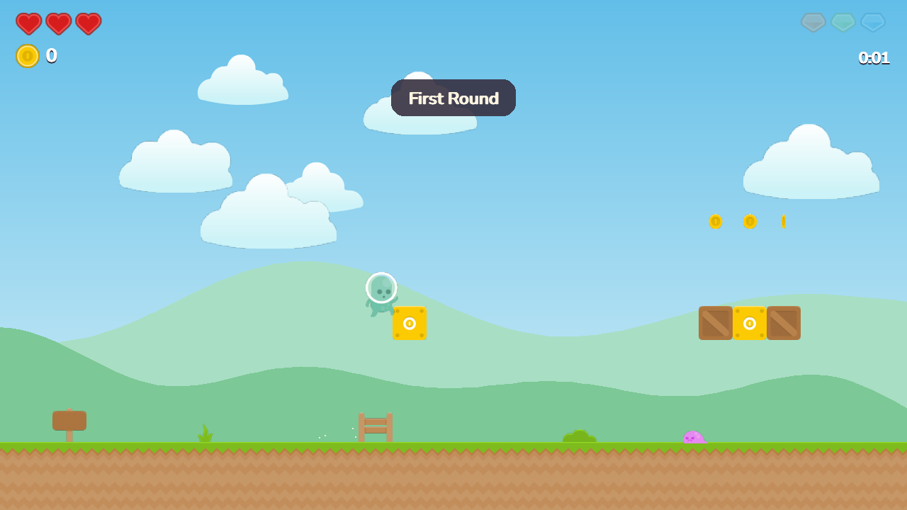
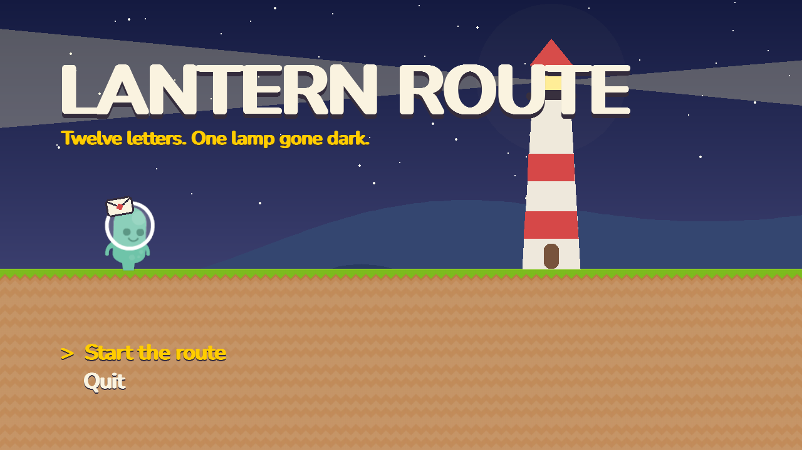
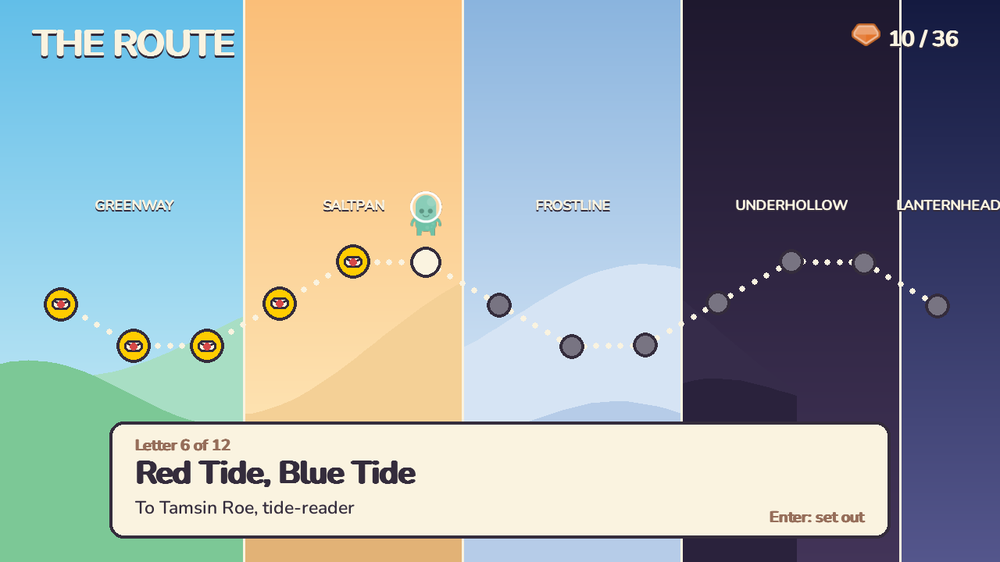
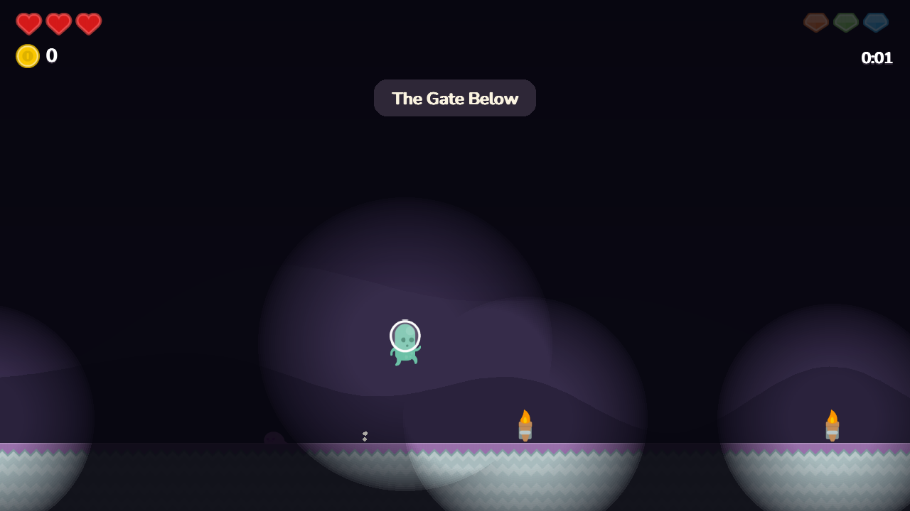

# Visual history

These images are screenshots from the games, captured from their renderers.

## Original recreation to Lantern Route

| Original World 1-1 recreation | Lantern Route: Greenway |
| --- | --- |
|  |  |

The original is a single Mario course. Lantern Route is a new side-scrolling
game with its own hero, hand-drawn tiles, story, and thirteen stages across
four regions and an epilogue.

## Starfall pilot to Lantern Route

| Starfall pilot title | Lantern Route title |
| --- | --- |
|  |  |

| Starfall pilot: orchard | Lantern Route: Greenway |
| --- | --- |
|  |  |

The Starfall pilot used 3D geometry and a five-stop campaign. Lantern Route
returns to 2D platforming with thirteen stages, a delivery story, letters,
collectible gems, and a route map.

| Lantern Route: route map | Lantern Route: Underhollow |
| --- | --- |
|  |  |

The Lantern Route screenshots were captured with `tools/shot.py`. The older
screenshots remain in this directory for comparison.
